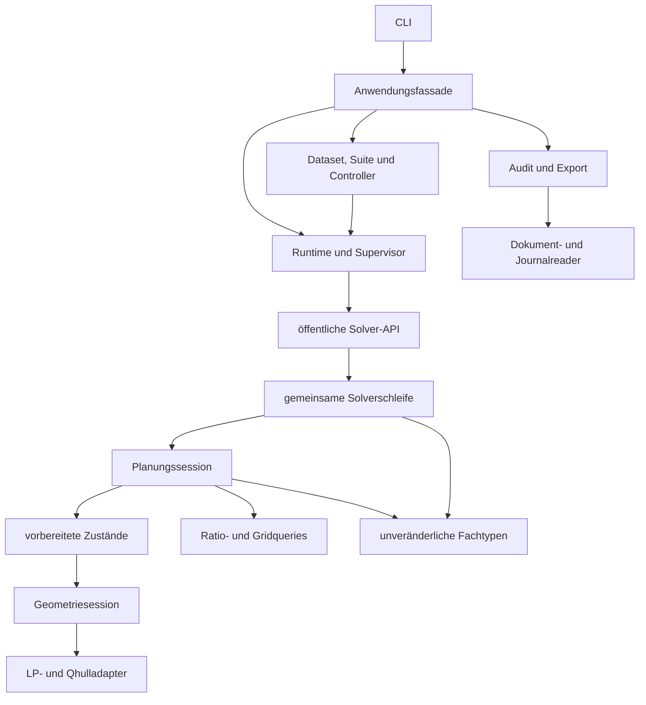

# Architektur und Zuständigkeiten

Der Rechenkern arbeitet ohne Dateien, Projektverzeichnis oder Benchmarkcontroller.
Die Anwendung ergänzt diese Mechanik um validierte Dokumente, kontrollierte
Prozesse, dauerhafte Aufzeichnung und unabhängige Auswertung.

## Module und Grenzen

| Modul | Verantwortung |
|---|---|
| `models`, `config`, `errors` | Fachliche Werte, getrennte Policy-/Budget-/Ausführungsparameter, Resultate, Ereignisse und Fehlerkontext |
| `execution`, `continuation`, `models.execution` | Reine Phasenübergänge, gebundene SDK-Fortsetzung und unveränderliche Cursor-/Versuchsevidenz |
| `api`, `solver`, `answers` | Öffentlicher Einstieg, genau eine tatsächliche Solverschleife und externe Antwortprovider |
| `planning` | Feste/adaptive Bewertung, lexikographische Auswahl, vollständige H3-Frontiers und Rootworker |
| `state`, `queries` | Gebundene Zustandsanalyse und geordnete Querymengen aus Ratiointervallen und Grid |
| `geometry`, `numerics` | Intrinsische Volumina, Antwortwahrscheinlichkeiten, numerische Guards und vorhandene exakte Recoveryverfahren |
| `runtime` | Projektgrenzen, Schemas, Wireprojektion, Buildidentität, Zulassung, Writer und Prozessbesitz |
| `experiments` | Neu erzeugte Inputs, explizite Suiteauswahl, eingefrorene Pläne, serialisierte Jobs und Wiederaufnahme |
| `analysis` | Unabhängige Journal-/Artefaktprüfung, rationale Oracleprüfung und nachvollziehbare Aggregate |
| `application_types`, `application`, `cli` | Leichte Anfragetypen, koordinierende Fassade und Argumentauflösung |

Fachtypen importieren keine Numerik, Dateilaufzeit oder Orchestrierung. Die
Rechenmodule importieren keine Runtime. Analyse verwendet gemeinsame Reader und
startet keinen Solver oder Prozesscontroller. Die Anfragetypen liegen außerhalb
der Fassade, damit untere Module keine zyklischen Rückabhängigkeiten benötigen.
Diese Grenzen werden auch durch Tests des Importgraphen geprüft.

## Lebensdauer der Berechnung

Jeder `solve`-Aufruf besitzt eine Planungssession. Diese besitzt Geometriesession,
LPbackend, begrenzte Caches und gegebenenfalls einen wiederverwendeten Rootpool.
Keine Session leert die Caches eines anderen Aufrufs. Die Cachekapazität hängt
nicht vom tatsächlichen Querybudget ab.

Ein vorbereiteter Zustand bindet Problem, Policy, Session, geordnete Antworten,
Constraints und vorhandene Analyse. Seine mathematischen Werte sind
unveränderlich; bei einem Kind entsteht ein eigener Builder. Workertransfers
enthalten mathematische Werte und keine geerbten nativen Handles, Locks oder
Sessions. Jeder Worker besitzt seine eigenen Handles. Nur unabhängige
Rootbewertungen werden verteilt, die Kindplanung bleibt seriell. Dadurch gibt
es keine verschachtelten Pools. Die Auswahlreihenfolge folgt der fachlichen
Ordnung und nicht der Ankunftsreihenfolge der Worker.

Der eigene Workerinitializer registriert unveränderliche Eingaben und lädt die
benötigten Geometrie- und Statemodule. Numerische Session, Backendhandles und
Finalisierung entstehen erst bei der ersten tatsächlichen Aufgabe. Importfehler
bleiben im betroffenen Worker gespeichert und werden erst dessen tatsächlichem
Auftrag zugeordnet. Globale Forkserverpreloads und fremde Sessions werden dafür
nicht verändert.

Die Solverschleife analysiert den tatsächlichen Zustand und prüft Singleton,
Konfidenz und Querybudget in dieser Reihenfolge. Erst dann wird geplant und eine
Query an den Provider übergeben. Ein `SolveFinished`-Ereignis folgt auf den
erfolgreichen Sessionabschluss. Fehler aus Provider, Recorder, Observer oder
Cleanup werden mit dem tatsächlich bekannten Teilkontext weitergegeben.

## Dauerhafte Ausführung

Die Runtime übersetzt vollständige Dateidokumente einmal in fachliche Objekte.
Ein expliziter `ProjectContext` bindet die stabile Projekt-ID und den realen Root.
Neue Laufdaten liegen unter dessen `runs/`, neue Eingabebundles unter `inputs/`.
Die Publikation hält die Pfadbindung durch Verzeichnishandles und
No-follow-Operationen bis zum Schreiben aufrecht.

Standalone und Serien verwenden denselben Supervisor und CaseProcess. Der
Supervisor schreibt einen Intent, prüft die echte Childregistrierung und bindet
einen StartGrant dauerhaft. Erst ein einmaliger Freigabepuls erlaubt numerische
Imports und den Solverstart. Ein geschlossenes Freigaberohr vor dem Puls beendet
das Kind ohne Solveraufruf.

Der CaseProcess ist der einzige Journalwriter. Start, Plan/Dispatch, gültige
Antwort und Terminalzustand besitzen Pflichtbarrieren. Ein Livezähler beruht auf
dem bestätigten Cursor und dessen verifiziertem Bytepräfix. Die Runtime hält das
fachliche Finish zunächst pending und terminalisiert Erfolg erst nach normalem
APIreturn. Dadurch wird ein fehlgeschlagener finaler Callback nicht als bereits
erfolgreich abgeschlossener Lauf gespeichert.

Ein Controllerlock verhindert parallele Controller derselben Serie.
Wiederaufnahme prüft zusätzlich die unveränderte Kette Intent, Registrierung,
Grant und Prozessidentität. Ein Status-PID allein genügt nicht. Ein lebender oder
unklarer Prozessbesitz sowie unbestätigte Startbytes blockieren einen neuen
Versuch. Ein berechtigter neuer Versuch beginnt mit den ursprünglichen Inputs;
alte Versuche bleiben erhalten.

## Identität und Auswertung

Ein Wheel enthält ein kanonisches Paketdateiinventar und unveränderliche
Buildprovenienz. Die Quellidentität bindet tatsächliche Python- und Schemabytes;
Dokumentation und neue Laufdaten ändern sie nicht. Das Ausführungsprofil bindet
separat Bibliotheksumgebung, Backendfähigkeiten und native Betriebsprüfungen.

Ein Audit verwendet gespeicherte Rawartefakte und einen eigenen unveränderlichen
Status-/Präfixsnapshot. Oraclequalität wird unabhängig mit `Fraction` aus den
gespeicherten Werten geprüft. Export benutzt genau den gewählten Auditstand.
Ungelöste, falsche, fehlerhafte, unterbrochene und noch offene Jobs bleiben
unterscheidbar und beeinflussen die ausgewiesenen Nenner entsprechend.

Die numerischen Verfahren und ihre Grenzen erklärt
[Numerik](numerical_behavior.md). Betriebsqualifizierung, mathematische
Vergleichsprüfung und Laufzeitabnahme sind getrennte Nachweise; die
[Laufzeitdokumentation](performance.md) beschreibt ihre Aussagegrenzen.

## Planung, Fortschritt und Ausführungsphase

`PlannerSession.plan(state, requested_depth=...)` beantwortet eine mathematische
Anfrage. Die Session bindet die unveränderliche Policy und speichert Ergebnisse
nach geordneter Historie und angefragtem Horizont. Ihr Cache enthält weder Cursor
noch Countdownneustartgründe. Fortschrittsprüfung und maximale Gewinnzeugen
entstehen während derselben vollständigen Bewertung ohne zusätzliche Geometrie.

Die Solverschleife hält den expliziten Cursor. Reine Funktionen in `execution`
bestimmen die angefragte Tiefe, die Berechtigung eines einmaligen vollen
Ersatzversuchs und die nächste Phase nach einer akzeptierten Antwort. Ein
`PlanningCycle` bindet die tatsächlichen Versuche und ihre Auswahl an den Cursor.
Numerik- oder Aufzeichnungsfehler können keinen fachlichen Ersatzversuch auslösen.

`SolveContinuation` bindet eine geordnete Historie und Phase an Problem und Policy.
Ein Warmstart beginnt dagegen bei voller Tiefe. Die native Fortsetzung ergänzt
den mathematischen Wert um einen unveränderlichen geprüften Herkunftspräfix und
passende Quellen-/Umgebungsbindung. Die native Serienwiederaufnahme beginnt
weiterhin einen neuen Versuch aus Originaleingaben.

## Versionierte Dokumentgrenzen

Die Registry adressiert `(Dokumenttyp, Version)`. Neue Konfigurationen und
Laufdokumente verwenden v2; unveränderte Problem-, Dataset-, Oracle- und
Umgebungsformate bleiben v1. Historische v1-Reader behalten ursprüngliche Digests,
fehlende deaktivierte Fortschrittsschwellen und die frühere Moduloausführung.
Ein ausdrücklicher Konverter schreibt neue Konfigurationen. Es gibt keinen
historischen zweiten Solver im Rechenkern.

Die neue mathematische Eingabeidentität bindet zusätzlich Startart, semantischen
Ausführungsvertrag und initialen Cursor. Ein abweichender nächster Horizont kann
damit nicht dieselbe Startidentität erhalten. Die Aufzeichnung bestätigt den
Cursor zusammen mit der Antwort; der algorithmische In-Memory-Cursor allein
behauptet keine Dauerhaftigkeit. Audit und Seal prüfen auch gemischte v1/v2-
Referenzketten.

Die Ereignisprüfung nutzt den eindeutigen `event_type` nur bei der bekannten
Schemaform als Diskriminator. Die ausgewählte Variante prüft weiterhin alle
Felder mit denselben strikten Typ- und Endlichkeitsregeln. Unbekannte Formen,
veränderte Auflösungskontexte und ungültige Daten verwenden den vollständigen
Validator einschließlich seiner bisherigen Fehlerreihenfolge.

Private kompilierte Schemadaten werden einmalig aus den unveränderten
JSON-Schemaressourcen vorbereitet. Neu angelegte Mappingproxies und unveränderliche
Tupel verhindern nachträgliche Änderungen; öffentliche Builder und exportierte
Schemadateien bleiben gewöhnliche JSON-Dokumente. Bekannte Enumknoten verwenden
für ursprüngliche Fehlertexte weiterhin den vollständigen ursprünglichen Handler.

Für die häufigen, formatfreien Plan- und Ausführungsevidenzen kann die Runtime
einen vollständigen positiven Strukturbeleg mit vorbereiteten Prädikaten prüfen.
Das gilt ausschließlich für die bekannten nativen Schemata, Referenzen und
Prüfkontexte. Der gesamte tatsächlich verwendete Schemaabschluss muss unterstützt
sein. Unbekannte Regeln, Referenzen, Typen oder veränderte Prüfumgebungen sowie
ein negativer Beleg führen zur vollständigen ursprünglichen Prüfung mit deren
Fehlerreihenfolge. Es gibt keinen Cache erfolgreicher Nutzdatenprüfungen.
Reentrante und parallele Aufrufe besitzen eigene, am Aufrufende zurückgesetzte
Autorisierungskontexte. Dateien, Hashes, numerische Werte und fachliche Übergänge
werden dadurch nicht als bereits geprüft übernommen. Der Schemaoptimierer
importiert keine Numerik und enthält keine Algorithmusentscheidungen.

Die versionsspezifischen Journalreader prüfen originale Bytes, Hash, Schema,
Sequenz, Zeitstempel und binary64-Evidenz. Danach verarbeitet ein privater
versionsneutraler Fold die strukturellen Übergänge. V2 projiziert die gemeinsamen
Records ausschließlich im Speicher; eine zweite Kodierung und erneute
Schemaprüfung dieser bereits geprüften Daten entfällt. Die eigenständige
V2-Prüfung von Cursor, Fortschritt und Ersatzplanung bleibt erhalten. Es gibt
weder einen öffentlichen Prüfungsbypass noch einen Artefaktcache. V1 behält seine
Prüfungsreihenfolge; eingefrorene Reader dienen nur als Differentialreferenzen
in kleinen Tests, nicht als zusätzlicher Produktionspfad.

Der [Implementierungsplan](implementation-plan-countdown-progress.md) enthält die
Abnahmematrix; der [Implementierungsstatus](implementation-status.md) hält die
an die konkrete Quelle gebundenen tatsächlich bestandenen Nachweise fest.
