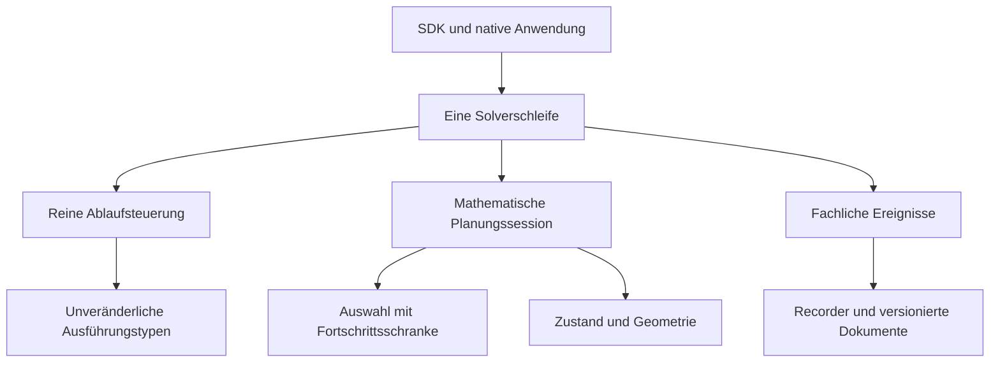

# Implementierungsplan für Countdown und Mindestfortschritt

Stand: 16. Oktober 2026. Status: Umsetzung autorisiert und im Integrationsbranch implementiert; die abschließende Abnahme läuft. Der normative Vertrag, die Arbeitspakete und Prüfkriterien dieses Plans bleiben verbindlich. Fortschritt und ursprünglicher Quellstand sind unter `runs/countdown-progress-integration-20261016T030055Z/` gesichert.

Countdown ist im Abnahmekandidaten ein regulärer Ausführungsmodus der festen Strategie. Eine zusätzliche Policy `min_expected_progress` begrenzt die Fortsetzung auf Pläne mit ausreichender erwarteter Verbesserung. Ihr Default ist `0.001`. Beide Funktionen sind in dieselbe Solverarchitektur, dieselben öffentlichen Schnittstellen und dieselbe nachvollziehbare Ausführung integriert.

Die gesicherte Hauptzweig-Ausgangsbasis ist `3f70c16c962d01a5846659dd0bb49f32899344a6`. Der ursprüngliche experimentelle Modulo-Countdown ohne Neustart und Fortschrittsschwelle wurde einschließlich seiner lokalen Änderungen separat als `codex/pre-countdown-progress-20261016` bei `d3877f2252bb8ab2c6c24d2ec52061f7b588bb4c` gesichert. Dieser Ausgangsstand ist keine unverändert übernommene Definition des neuen Vertrags. Die reguläre Integration liegt auf `codex/countdown-progress-integration`.

## Umsetzungs- und Abnahmestand

Der aktuelle Release-6-Kandidat von Version `0.2.0` enthält zusätzlich die
gezielte Optimierung der nativen Formatprüfung. Sein Paket-/Quellinventar ist
`cd8137876aabd8041f36aa4494b068d13f07f6d94c6fe5c6843064880e68c63b`. Alle 662 Tests
bestanden im tatsächlichen Hauptcheckout in 45,40 Sekunden; Ruff ist sauber.
Die isolierte Vorprüfung bestand dieselben 662 Tests sowie unabhängige
Schemavergleiche. Alle 40 Schemaressourcen sind unverändert. Ein neuer Build,
installierte Qualifizierung und frische Laufzeitgates bleiben erforderlich.

Release 5 bestand zuvor 34 macOS- und 39 Linux-Betriebskontrollen,
öffentliche Fortsetzungen und Acht-Job-Workflows auf beiden Hosts sowie die
128 SDK-Kontrollen. Seine native Laufzeitprüfung scheiterte jedoch bei allen
zwölf Bedingungen trotz gleicher Rechnungen. Profile zeigen wiederholte
Schemaarbeit als Hauptursache. Release 6 wählt eindeutige Ereignisschemata direkt
und verwendet einen gemeinsamen strukturellen Journal-Fold nach vollständiger
Originalprüfung. Daten, Barrieren und fachliche Prüfungen bleiben erhalten.
Frühere Versuche werden nicht als Freigabe der neuen Quelle übertragen.

Konkrete Quellen, Prüflogs und Quittungen stehen im
[Implementierungsstatus](implementation-status.md) und im
[laufenden Abnahmenachweis](../runs/countdown-progress-integration-20261016T030055Z/implementation-state.json).
Die große Studie ist noch nicht gestartet. Diese Statusbeschreibung ersetzt
keines der nachfolgenden Abnahmekriterien.

## Ziel und Umfang

Nach der Umsetzung stehen drei Ausführungsvarianten zur Verfügung:

| Strategie | Ausführung | Bedeutung |
| --- | --- | --- |
| `fixed` | `receding` | Nach jeder tatsächlichen Antwort erneut mit der konfigurierten Tiefe planen. |
| `fixed` | `countdown` | Die tatsächlich verwendete Planungstiefe nach Antworten herunterzählen und bei Bedarf einen neuen Block beginnen. |
| `reduction_per_query` | `receding` | Alle Horizonte von eins bis zur konfigurierten Tiefe betrachten und den zulässigen Plan mit der besten erwarteten Verringerung pro erwarteter Query wählen. |

`reduction_per_query` mit `countdown` bleibt ungültig. `receding` bleibt der Default des Ausführungsmodus. Der neue Default `0.001` betrifft den Mindestfortschritt aller drei gültigen Varianten.

Die Integration umfasst Fachtypen, Policy, mathematische Auswahl, Ablaufsteuerung, SDK, native Aufzeichnung, Audit, Export, Konfigurationsbeispiele und Produktdokumentation. Es entsteht keine eigene Solverschleife für Countdown und keine Sonderimplementierung im Benchmarkcontroller.

Der anschließend gewünschte größere Vergleich von Neuplanung, Countdown und adaptiver Strategie bei verschiedenen Grids wird im separaten [Benchmarkplan für Strategien und Gridgrößen](benchmark-plan-strategy-grid-comparison.md) konkretisiert. Er folgt nach der Implementierung und deren Abnahme; sein vorgeschlagener Umfang sind 100 neue Probleme mit zwölf Bedingungen aus drei Strategien und Grid 3, 5, 10 und 20.

Geometrische Antwortwahrscheinlichkeiten, Querygeneratoren, numerische Toleranzen und zulässige Planungstiefen bleiben dieselben fachlichen Verfahren. Die Fortschrittsschwelle ist eine neue Abbruchstrategie. Laufzeitgewinne durch frühere ungelöste Abschlüsse werden deshalb getrennt von reinen Implementierungsverbesserungen ausgewiesen.

## Verbindlicher Parametervertrag

`AlgorithmPolicy` erhält das zusätzliche, vorzugsweise nur per Schlüsselwort übergebbare Feld:

```python
min_expected_progress: float | None = 0.001
```

| Eingabe | Bedeutung |
| --- | --- |
| Nicht angegeben bei einer neuen SDK-Policy | `0.001` |
| Endliche reelle Zahl größer oder gleich null | Aktive Fortschrittsprüfung mit genau diesem Wert |
| `None` im SDK beziehungsweise `null` in einer neuen Konfiguration | Fortschrittsprüfung ausdrücklich deaktiviert |
| `0.0` | Strikt positiven berechneten Fortschritt verlangen |
| Negative Zahl, Boolean, String, NaN oder Unendlich | Validierungsfehler vor dem Solverstart |

Die Zahl wird einmal nach binary64 projiziert und als solche in Policy, Identität und Evidenz verwendet. Bestehende Positionsargumente werden nicht verschoben. Eine große endliche Schwelle ist zulässig; sie kann regulär zu einem ungelösten Fortschrittsabschluss führen.

Die neue Konfigurationsdateiversion verlangt einen ausdrücklich gespeicherten Wert. Dadurch ist bei nativen Läufen sichtbar, ob `0.001`, ein anderer Wert oder die ausdrückliche Deaktivierung verwendet wurde. Beispielgeneratoren schreiben den SDK-Default aus, statt die Auflösung dem späteren Reader zu überlassen.

## Definition des erwarteten Fortschritts

Sei `C` die Kandidatenzahl im tatsächlichen Zustand vor der nächsten Frage und `P` ein vollständiger, für einen Horizont bewerteter Plan.

Bei gewöhnlicher Kandidatenbewertung gilt:

```text
progress(P) = float(C) - P.expected_terminal_candidates
```

Bei abbruchbewusster Bewertung gilt:

```text
progress(P) = float(C) - P.expected_terminal_loss
```

Ein innerhalb der Planung akzeptierter Singleton- oder Konfidenzabschluss hat den bestehenden effektiven Loss eins. Die tatsächliche Kandidatenzahl bleibt daneben separat sichtbar. Ein bloßer Anstieg eines Volumenanteils unterhalb der konfigurierten Abbruchschwelle zählt bei unveränderter Kandidatenzahl weiterhin nicht als Lossverbesserung.

Ein Plan ist bei aktiver Schwelle `t` zulässig genau dann, wenn:

```text
progress(P) > t
```

Gleichheit genügt nicht. Der Vergleich verwendet die tatsächlich berechneten, von der Anzeige unabhängigen binary64-Werte. Die Reihenfolge bleibt ausdrücklich `progress = C - loss` und anschließend `progress > threshold`; sie wird wegen möglicher Rundungsunterschiede nicht zu `loss < C - threshold` umgestellt. Es gibt kein zusätzliches `isclose`, keine neue Mindestwahrscheinlichkeit, kein Clamping und keine Vermischung mit den vorhandenen numerischen Fehlertoleranzen. Bereits ungültige numerische Ergebnisse bleiben Fehler; sie werden nicht als unzureichender Fortschritt behandelt.

Die Schwelle ist absolut in Einheiten des verwendeten Kandidaten-Losses. Sie ist weder ein Prozentwert noch eine Verringerung pro Query. Die adaptive Rate bleibt:

```text
rate(P) = progress(P) / P.expected_queries
```

Die Fortschrittsprüfung betrifft vollständige Pläne am tatsächlichen Entscheidungspunkt. Einzelne hypothetische Äste oder vorbereitende Queries erhalten keine eigene lokale Schwelle. Andernfalls würden sinnvolle mehrstufige Pläne entfernt und die bisherige Erwartungswertberechnung verändert. Ebenso wird ein Countdown-Neustart nicht heimlich in die hypothetische Rekursion eingebaut: Ein Horizont von drei bleibt eine Betrachtung von höchstens drei Queries.

## Auswahl unter zulässigen Plänen

### Feste Strategie

Bei gewöhnlicher fester Planung wird weiterhin die lexikographische Bewertung des angefragten Horizonts verwendet. Minimaler terminaler Kandidatenwert entspricht maximalem Fortschritt. Überschreitet bereits das Minimum die Fortschrittsschranke nicht, erfüllt keine andere bewertete Query dieses Horizonts die Schranke.

Bei abbruchbewusster fester Planung gilt dieselbe Überlegung für den minimalen effektiven Loss. Die bestehende Queryidentität entscheidet weiterhin die definierten Gleichstände. Die Schwelle verändert nicht die Berechnung hypothetischer Kinder.

### Adaptive Strategie

Die Zulässigkeit muss vor der endgültigen Ratenwahl greifen. Ein nachträglicher Test allein des bisherigen Ratensiegers ist falsch: Dieser kann einen sehr kleinen Gesamtgewinn haben, während ein anderer, etwas teurerer Plan genügend Gewinn erzielt.

Der Selektor ermittelt über alle Horizonte `1..depth`:

1. den nach bestehendem Ratenvergleich besten zulässigen vollständigen Plan;
2. den Plan mit maximalem Gesamtfortschritt als Abbruchzeugen, falls kein Plan zulässig ist;
3. pro Horizont die tatsächlich betrachtete Abdeckung und den jeweiligen Ausgang.

Die bestehenden nachgeordneten Auswahlkriterien bleiben erhalten: erwartete Querykosten, Horizont und deterministische Query-/Fortsetzungsidentitäten. Ankunftsreihenfolgen paralleler Worker entscheiden keine Gleichstände.

Bei Tiefe drei muss die Schranke bereits innerhalb der abschließenden Kombination der Kindfrontiers berücksichtigt werden. Pro Rootquery nur den ungefilterten Ratensieger zurückzugeben und diesen anschließend zu verwerfen reicht nicht. Ein zulässiger anderer Fortsetzungsplan derselben Rootquery muss auswählbar bleiben.

Während der ohnehin nötigen Enumeration werden zulässiger Sieger und maximaler Fortschrittszeuge gemeinsam geführt. Es gibt keine zweite geometrische Auswertung zur Erzeugung eines Abbruchsbelegs. Eine große Schwelle ist kein Grund, vorzeitig ganze Horizonte oder Querymengen auszulassen.

### Verbindlicher Kontrollfall für adaptive Auswahl

Für zwei Ausgangskandidaten und zwei gleich wahrscheinliche Antwortäste besitzt jede Kindfrontier zwei nichtdominierte Optionen:

| Option | Terminaler Loss | Erwartete Folgequeries |
| --- | --- | --- |
| A | `1.99900015` | `1.99900015` |
| B | `1.99899995` | `2.0` |

Der vollständige Plan AA hat die bessere ungefilterte Rate, aber nur ungefähr `0.00099985` Gewinn. BB hat ungefähr `0.00100005` Gewinn und ist bei der vereinbarten Schwelle zulässig. Die neue Auswahl muss BB finden. Ein Ergebnis „kein ausreichender Plan“ wäre falsch.

Dieser synthetische Test prüft die reine Kombinationsfunktion. Er behauptet keine bestimmte geometrische Erreichbarkeit dieser Zahlen und ersetzt keine zusätzlichen analytischen Geometriefälle.

## Numerisch sichere Frontierauswahl

Die Architekturprüfung hat einen isolierten Rundungsgrenzfall der bestehenden partiellen Frontierprojektion ergeben: Gerundete Gleichheit zweier Zwischensummen kann eine Option entfernen, deren vollständiger `fsum` später besser ist. Das ist ein begrenzter Befund der reinen Kombinationsfunktion, kein nachgewiesener Fehler eines historischen Benchmarkgewinners. Die neue Zulässigkeitsschranke macht eine nachvollziehbare Behandlung dieser Grenze erforderlich.

Die Implementierung erhält die finale Scorearithmetik: vorhandene Produkte, `fsum`, Subtraktion und Division. Die Pruningentscheidung erhält dagegen eine konservative Dominanzbegründung:

- Für die bereits gerundeten Produkte `p * loss` und `p * cost` werden intern zusätzlich exakte binäre Summen geführt. Diese dienen ausschließlich als Dominanzzertifikat und verändern nicht die geometrischen Volumina oder Endscores.
- Eine Präfixoption darf eine andere nur verdrängen, wenn ihr zertifizierter Loss und ihre zertifizierten Kosten jeweils nicht größer sind. Um auch spätere Rundungsgleichstände im vollständigen Auswahlkey korrekt zu behandeln, muss ihre Präfixidentität ebenfalls nicht größer sein.
- Derselbe Identitätsschutz gilt beim Weglassen von Kindoptionen, deren echter Vorteil bei späterer Gewichtung wegrunden könnte.
- Nach dem letzten positiven Antwortast werden die vollständigen nativen Scores bewertet. Erst hier greift die globale Fortschrittsschwelle und danach die Rate.
- Bei deaktivierter Schwelle ist Dominanz für die Ratenwahl nur mit nachgewiesener Nichtnegativität des relevanten Gewinns zulässig. Für den seltenen numerischen Fall ausschließlich negativer Gewinne werden die ungekürzten vorhandenen Optionen ausgewertet; dafür bleiben Rohoptionen vor beiden Pruningstufen verfügbar. Es wird nichts auf null korrigiert.

Ein kleines privates Hilfsmodul für binäre Summen und Dominanz ist zulässig. Es gehört in `planning`, bleibt rein und enthält keine Geometrie oder Laufdateien. Die zertifizierte Präfixprojektion wird nach exakten Kosten sortiert und verwendet eine Präfixminimumstruktur über deterministischen Identitätsrängen, sodass keine quadratische Dominanzsuche in die gewöhnliche Ausführung eingebaut wird. Für höchstens drei positive Antwortäste bleibt die Struktur eng begrenzt; die vollständige kartesische Enumeration dient als unabhängige Testreferenz.

Tests müssen insbesondere `nextafter`-Nachbarwerte, vollständige Schlüsselgleichstände und gerundete Zwischensummengleichheit abdecken. Eine Änderung gegenüber der bisherigen Auswahl wird nur bei einem begründeten Korrektheitsfall akzeptiert und separat dokumentiert. Sie darf nicht als durch die Fortschrittsschwelle beabsichtigte Verhaltensänderung versteckt werden.

## Architektur der Ausführung

Die drei Verantwortungen bleiben getrennt: mathematische Planberechnung, Prüfung der Planzulässigkeit und Fortschreiben der tatsächlichen Ausführungsphase.



| Modul | Zukünftige Verantwortung |
| --- | --- |
| `config.py` | Statische Policy einschließlich Modus und Fortschrittsschwelle; kein laufender Cursor |
| `models/execution.py` neu | Unveränderliche Cursor, Planungsversuche und Entscheidungsevidenz ohne Numerik oder Runtime |
| `models/planning.py` | Mathematische Plan-, Score- und Horizontergebnisse, einschließlich unterschiedener Auswahlausgänge |
| `execution.py` neu | Reine Phasenfunktionen und zulässige Übergänge; keine Session-, Provider- oder Recorderaufrufe |
| `planning/session.py` | Berechnung für ausdrücklich angefragte Horizonte und vollständige zulässige Auswahl |
| `planning/frontier.py` und gegebenenfalls kleines Hilfsmodul | Globale Kombination, konservative Dominanz und deterministische Rateauswahl |
| `solver.py` | Orchestrierung der einen tatsächlichen Antwortschleife, Stoppräzedenz und maximal eines Fallbacks |
| `continuation.py` neu | Leichter, gebundener SDK-Fortsetzungswert; getrennt von `models`, um Importzyklen mit `config` zu vermeiden |
| `runtime` | Persistente Bindung und Prüfung der tatsächlich ausgeführten Übergänge |
| `analysis` | Unabhängige Interpretation der gespeicherten Evidenz, ohne erneute Solverausführung |

Die bestehenden Importgrenzentests werden auf die neuen Module erweitert. `models`, `config`, `continuation` und die reinen Ausführungsfunktionen laden weder NumPy/SciPy noch Runtime, Dateien oder Prozesse. Kein Cursor wird Bestandteil eines LP-Modells, eines geometrischen Zustands oder eines Workertasks.

## Fachliche Schnittstellen

Die konkreten Datentypen werden in einem eigenen Fachtyp-Arbeitsschritt eingeführt. Ihr verbindlicher Informationsgehalt lautet:

```text
ExecutionCursor
    answered_total
    remaining_depth

ProgressEvidence
    basis: candidate_count | effective_loss
    starting_value
    expected_terminal_value
    expected_progress
    threshold: float | None
    comparison: strict_greater
    admissible

PlanningAttempt
    requested_depth
    evaluated_horizons
    outcome: available | no_query | insufficient_expected_progress
    selected_plan: PlanningDecision | None
    selected_progress: ProgressEvidence | None
    best_progress_witness: bewerteter Plan | None
    horizon_evidence: tuple[HorizonSelectionEvidence, ...]

HorizonSelectionEvidence
    horizon
    generated_query_count
    evaluated_query_count
    outcome
    selected_plan: PlanningDecision | None
    selected_progress: ProgressEvidence | None
    best_progress_witness: bewerteter Plan | None
    best_progress: ProgressEvidence | None

PlanningCycle
    cursor_before
    attempts: genau ein Versuch oder Countdownversuch plus voller Ersatzversuch
    selected_plan: PlanningDecision | None
    outcome
    restart_reason: None | no_query | insufficient_expected_progress
    proposed_cursor_after_answer: ExecutionCursor | None
```

`NoQuery` behält seine Bedeutung „keine verfügbare Query im angefragten Querysatz“. Ein vorhandener, unzureichender Plan wird nicht als leeres Queryinventar ausgegeben. Intern kann dafür ein gesonderter Typ `InsufficientExpectedProgress` verwendet werden; der öffentliche Ergebnisgrund lautet einheitlich `insufficient_expected_progress`.

Der Planer erhält einen expliziten Horizont:

```text
PlannerSession.plan(state, *, requested_depth) -> PlanningAttempt
```

Für Fixed ist dies die exakt zu betrachtende Tiefe. Für Adaptive ist es die Obergrenze `1..requested_depth`. Das bisherige `policy.depth_at(len(history))` entfällt aus der regulären mathematischen Planung. Interne Berechnungsfunktionen dürfen weiterhin reine mathematische Planwerte liefern; die Ausführungshülle wird nicht in diese Rekursion verlagert.

Die Policy ist für die gesamte Session unveränderlich. Der mathematische Plancache verwendet weiterhin geordnete binary64-Historie und ausdrücklich angefragte Tiefe als Schlüssel. Der Policywert einschließlich Schwelle und das numerische Profil sind durch die Session gebunden. Cursor, Fallbackgrund und `PlanningCycle` gehören nicht in diesen Cache. Ein Cachetreffer muss für den aktuellen Cursor eine neue korrekte Ausführungshülle erhalten.

## Countdown als explizite Zustandsmaschine

Sei `D` die konfigurierte Maximaltiefe, `r` die nächste Resttiefe und `n` die Anzahl akzeptierter Antworten. Im regulären Countdown wird die Phase explizit gehalten. Die Antwortzahl allein genügt nach einem vorgezogenen Blockneustart nicht mehr.

| Bedingung | Aktion | Phase und Zähler |
| --- | --- | --- |
| Neuer Lauf oder Warmstart | Mit `D` beginnen | Cursor `(n, D)` |
| Tatsächlicher Singleton erreicht | Erfolgreich beenden | Keine Planung |
| Tatsächliche aktive Konfidenzschwelle erreicht | Erfolgreich beenden | Keine Planung |
| Antwortbudget erreicht | `max_questions` | Keine Planung und kein Fallback |
| Ausreichender Plan bei `r` | Seine Query auswählen | Vor gültiger Antwort kein Fortschreiben |
| `no_query` bei `r < D` | Im selben tatsächlichen Zustand einmal mit `D` planen | Keine Query oder Antwort zusätzlich zählen |
| Unzureichender Fortschritt bei `r < D` | Den Restplan verwerfen und einmal mit `D` planen | Ablehnungsgrund erhalten |
| Ausreichender Ersatzplan bei `D` | Dessen Query auswählen; neuer Block vorgesehen | Nach gültiger Antwort `(n+1, D-1)`, bei `D=1` wieder eins |
| `no_query` beim vollen Versuch | Regulär ungelöst mit `no_query` beenden | Kein weiterer Retry |
| Unzureichender Fortschritt beim vollen Versuch | Regulär ungelöst mit `insufficient_expected_progress` beenden | Kein weiterer Retry |
| Gültige Antwort auf tatsächlich verwendeten Horizont `h > 1` | Antwort akzeptieren | Countdowncursor `(n+1, h-1)` |
| Gültige Antwort auf Horizont eins | Antwort akzeptieren | Countdowncursor `(n+1, D)` |
| Fehler oder ungültige Antwort | Fehler weitergeben | Kein Fallback als Fehlerbehandlung |

Ein fehlgeschlagener Ersatzversuch beginnt keinen Block. Ein ausgewählter Ersatzplan beginnt den neuen Block erst mit der gültigen tatsächlichen Antwort. Wiederholtes Planen desselben Zustands verändert die Phase nicht. Für Receding und Adaptive ist die nächste angefragte Tiefe nach einer Antwort stets `D`.

Beispiel bei `D=3`:

```text
3 [Antwort] → 2 [Antwort] → 1 [unzureichend]
                         → 3 [Ersatzplan und Antwort] → 2 → 1 → 3 ...
```

Pro tatsächlichem Zustand gibt es höchstens zwei Planungsversuche. Bei `r=D` und bei `D=1` wird kein identischer zweiter Versuch gestartet. Zustand, Gewichtsbeschränkungen und Antworten bleiben zwischen Rest- und Ersatzplanung unverändert. Die Session und ihr vorhandener Workerpool werden wiederverwendet.

## Solverablauf und Fehlergrenzen

Die gemeinsame Solverschleife folgt dieser Reihenfolge:

1. Tatsächlichen Zustand analysieren und die bereits vorhandenen Invarianten prüfen.
2. Den Record einer zuvor beantworteten Query abschließen.
3. Singleton, aktive Konfidenz und danach Gesamtantwortbudget prüfen.
4. Erforderlichen Horizont aus dem Cursor bestimmen und genau einen Planungsversuch ausführen.
5. Nur bei Countdown, verkürzter Resttiefe und fachlich unzureichendem Ausgang den vollen Ersatzversuch ausführen.
6. Den vollständigen `PlanningCycle` veröffentlichen, auch wenn keine Query folgt. Start und erfolgreicher Abschluss jedes tatsächlichen Planungsversuchs werden zusätzlich als kleine Lebenszyklusereignisse erfasst.
7. Bei fachlichem Planungsende regulär ungelöst abschließen; ansonsten die ausgewählte Query planen und dispatchen.
8. Antwort validieren, akzeptierte Historie und algorithmischen Cursor gemeinsam aktualisieren und das Antwortereignis veröffentlichen.
9. Erst nach der erforderlichen Antwortbarriere den Folgezustand berechnen.

Ein numerischer Fehler, Workerfehler, Providerfehler, ungültige Antwort oder Recorderfehler wird niemals in `no_query` oder einen fehlenden Fortschritt umgedeutet. Bestehende Fehlerkategorien und Cleanupverantwortung bleiben bestehen. Kein Event kündigt eine tatsächliche Query an, die lediglich hypothetisch bewertet oder verworfen wurde.

Der neue reguläre Endgrund ist `insufficient_expected_progress`, mit `solved=False` und ohne ausgewählte Alternative. Die vier bisherigen Endgründe bleiben erhalten. Ein Singleton oder Konfidenzabschluss hat Vorrang vor Budget und Fortschritt; ein Budgetabschluss hat Vorrang vor zusätzlicher Planung.

## Anfangshistorie und echte Fortsetzung

`initial_answers` enthält mathematische Antworten, aber keine früheren Countdown-Neustarts. Der neue Vertrag unterscheidet daher ausdrücklich:

- **Warmstart:** `initial_answers` allein schränkt den Gewichtsraum ein und beginnt einen neuen vollständigen Block bei `D`. Die Antworten zählen weiterhin zum Gesamtbudget.
- **Explizite Fortsetzung:** Ein `SolveContinuation` bindet geordnete Antworten und Cursor an genau dasselbe Problem und dieselbe Policy. Nur diese Eingabe reproduziert eine bestehende Blockphase.
- **Native Serienwiederaufnahme:** `benchmark resume` behält seinen bisherigen Vertrag. Ein berechtigter neuer Versuch beginnt aus den ursprünglichen Eingaben; fertige Fälle werden übersprungen und alle früheren Versuche bleiben erhalten. Es wird dadurch keine automatische Fortsetzung innerhalb eines unterbrochenen Solveraufrufs eingeführt.

Die SDK-Signatur erhält das zusätzliche Schlüsselwort `continuation=None`. Eine Continuation und eine nichtleere zusätzliche Anfangshistorie sind gegenseitig ausgeschlossen. Der Fortsetzungswert wird außerhalb des kleinen Modellpakets definiert, wenn er direkt `AlgorithmPolicy` bindet. `SolveResult` und `PartialContext` halten den aktuellen `ExecutionCursor`; eine Hilfsfunktion stellt daraus den gebundenen Fortsetzungswert her.

Validierung prüft Historienlänge, `1 <= remaining_depth <= D`, genaue Problem-/Policybindung einschließlich binary64-Werten und den Versionstag des Fortsetzungsvertrags. Im SDK ist ein manuell deklarierter, strukturell gültiger Cursor eine ausdrückliche Eingabe des Aufrufers; ohne Ereignisherkunft kann daraus kein ursprünglicher Ablauf bewiesen werden. Die Hilfsfunktion aus Ergebnis oder akzeptiertem Teilkontext bewahrt die dort vorhandene Bindung. Die strengere native Fortsetzung verlangt zusätzlich die nachfolgend definierte Herkunftsevidenz.

Ein Cursor ist kein Beleg für eine beantwortete offene Query. Dispatch ohne passende akzeptierte Antwort verhindert den automatischen Continuationexport. Eine bereits dauerhaft akzeptierte Antwort mit gespeichertem Folgecursor ist dagegen auch dann exportierbar, wenn die Folgeanalyse oder `QueryCompleted` noch fehlt. Der bestehende offene Queryrecordbezug allein bedeutet keine unbeantwortete Providerfrage. Die neue Session berechnet den Zustand aus der bestätigten Historie erneut; Provideraufrufe werden nicht still wiederholt.

Für native explizite Fortsetzung wird ein eigener Dokumenttyp mit Problem-/Konfigurationsreferenz, Antworten und Cursor eingeführt. Sein `origin_proof` bindet das ursprüngliche v2-Manifest, Bytezahl, letzte Sequenz und Hash einer unveränderlich exportierten, geprüften Journalpräfixdatei bis zur bestätigten Antwortgrenze. Das Manifest bindet zusätzlich Quellinventar und qualifiziertes numerisches Ausführungsprofil; der Import gleicht diese mit der tatsächlich vorgesehenen Quelle und Umgebung ab. Der Export kopiert nur den verifizierten Präfix in ein neues Eingabebundle und ergänzt dessen Hash; er referenziert nicht einen später weiterwachsenden Journalinhalt als unveränderliche Datei. Der Reader leitet akzeptierte Antworten und Phase erneut aus dieser Evidenz ab und gleicht sie mit dem deklarierten Inhalt ab. Ein frei behaupteter Cursor ohne Herkunftsevidenz ist keine native bestätigte Fortsetzung. Die vorhandene referenzielle Materialisierung nimmt die vollständige kleine Belegkette mit auf.

Die CLI erhält `--continuation` als Alternative zu `--initial-answers`; beide Wege verwenden dieselbe SDK-API. Der gezielte Export wird als `otqa continuation export --result ... --output ...` über eine leichte Anwendungsanfrage angeboten. Er prüft das Resultat einschließlich seiner bestätigten Journalgrenze und erzeugt ein neues Bundle unter `inputs/`, ohne Ursprungsdateien zu verändern. Resultate ohne zulässige bestätigte Antwortgrenze oder mit unbeantwortetem Dispatch werden abgewiesen. Eine passende Quelle/Umgebung ist Voraussetzung des anschließenden Imports, nicht einer bloßen Offlineprüfung der alten Bytes.

Ein unverändertes vollständiges Antwortdokument bleibt ein Warmstart. Eine native Fortsetzung stammt ausschließlich aus einer überprüften, dauerhaft bestätigten Antwortgrenze; die SDK-Werte garantieren demgegenüber fachliche Konsistenz und behaupten ohne Recorder keine Dauerhaftigkeit. Kein In-Memory-Fehlerkontext wird als dauerhaft gesicherter Checkpoint bezeichnet.

Der v2-Vertrag für mathematische Eingabeidentität bindet zusätzlich zur bisherigen Antwort-/Policyprojektion den kanonischen Starttyp, den semantischen Ausführungsvertrag und den initialen `ExecutionCursor`. Dieselben Antworten mit unterschiedlicher Resttiefe können zu verschiedenen nächsten Queries führen und dürfen deshalb nicht denselben v2-Digest erhalten. Operative Dateinamen oder Lauf-IDs werden nicht zu mathematischen Werten. Identische effektive Fortsetzungen erhalten unabhängig vom Ablagepfad dieselbe Startprojektion. Der bestehende v1-Digest bleibt byte- und semantikgleich.

Die Bezeichnung `execution_kind="continuation"` für jeden bisherigen Lauf mit bloßer Anfangshistorie wird im neuen Laufvertrag auf `warm_start` präzisiert. Vollständige algorithmische Fortsetzung setzt gleiche Quelle und numerische Umgebung voraus; ein Cursor verspricht keine identischen Entscheidungen zwischen beliebigen Softwareversionen.

## Ereignisse und dauerhafte Evidenz

Ein neues fachliches Ereignis `PlanningResolved` trägt den `PlanningCycle` für den aktuellen tatsächlichen Zustand. Es entsteht genau einmal nach Abschluss der ein oder zwei Planungsversuche. Darin werden auch verworfene Restpläne und terminale Fälle ohne nächste Query festgehalten. `PlanningAttemptStarted` und `PlanningAttemptCompleted` dokumentieren zusätzlich die tatsächlichen Versuchsränder, ausschließlich in der Solverschleife und niemals für rekursive hypothetische Kinder. Sie erlauben, einen abgeschlossenen Restversuch und einen begonnenen Ersatzversuch auch dann zu erhalten, wenn die Ersatzplanung fehlschlägt.

| Ereignis | Dauerhaft nachzuweisender Inhalt |
| --- | --- |
| `StateAnalyzed` | Tatsächlicher Zustand und Anzahl akzeptierter Antworten |
| `PlanningAttemptStarted` neu | Zustandsposition, Cursor, Versuchsindex und angefragter Horizont; kein Querydispatch |
| `PlanningAttemptCompleted` neu | Derselbe Versuch mit vollständigem Auswahlausgang und vorhandener Fortschrittsevidenz |
| `PlanningResolved` neu | Cursor vorher, tatsächliche Versuche, Horizontabdeckung, Ausgänge, Fortschrittsbasis/-wert/-schwelle, ausgewählter Plan oder Abbruchzeuge, vorgesehener Folgecursor |
| `QueryPlanned` | Genau die durch den Planungszyklus ausgewählte Query |
| `QueryDispatched` | Übergabe an den Antwortgeber, gebunden an dieselbe Entscheidung |
| `AnswerReceived` | Tatsächlich akzeptierte Antwort und der dadurch entstandene Cursor |
| `QueryCompleted` | Berechneter Folgezustand und Bezug auf dieselbe Planungsentscheidung |
| `SolveFinished` | Reguläres Ergebnis einschließlich finalem Cursor und gegebenenfalls terminalem Planungsbeleg |

Die native Aufzeichnung erhält entsprechend `planning_attempt_started`, `planning_attempt_completed` und `planning_resolved`. Queryrecords und Resultat müssen dieselben Entscheidungswerte referenzieren beziehungsweise exakt wiedergeben. Ein Fortschrittsstopp braucht insbesondere den maximalen Fortschrittszeugen je erforderlichem Horizont; allein der beste Ratensieger beweist keine ausgeschöpfte Fortschrittssuche. Bei einem unvollständigen Versuch gibt es keinen erfundenen vollständigen Zyklus. `PartialContext` hält den begonnenen Zyklus und bereits abgeschlossene Versuche; ein normal gespeicherter Fehlerabschluss erhält diese Information.

Die Standardaufzeichnung hält die erforderlichen Zusammenfassungen und vorhandenen Gewinner-/Abbruchszeugen. Vollständige verworfene Suchbäume bleiben dem bestehenden begrenzten Diagnosecapture vorbehalten. Für die Aufzeichnung werden keine Volumina, LPs oder Pläne erneut berechnet.

### Bestätigte Grenzen

Die bestehende Dauerhaftigkeit wird erweitert, ohne jeden verworfenen Restversuch mit einer zusätzlichen Pflichtsynchronisation zu belasten:

- Die Dispatchbarriere bestätigt den davor gespeicherten Planungszyklus und die ausgewählte Query, bevor der Provider aufgerufen wird.
- Die Antwortbarriere bestätigt Antwort und neuen Ausführungscursor gemeinsam.
- Die Terminalbarriere bestätigt einen fachlichen Planungsabbruch auch dann, wenn keine Query gestellt wurde.
- Start-/Abschlussereignisse der Versuche werden ohne zusätzlichen Pflicht-Fsync angehängt und an der nächsten vorhandenen Dispatch-, Antwort- oder Terminalbarriere mitbestätigt. Unterbrechung während der Planung ist nur insoweit als geprüft sichtbar, wie sie der bestätigte Präfix tatsächlich belegt; unbestätigte Tailbytes werden nicht hochgezählt.

Der algorithmische SDK-Cursor entsteht mit der gültig akzeptierten Antwort. Der dauerhaft bestätigte Runtimecursor entsteht erst nach erfolgreichem Journal-Fsync und Veröffentlichung des Progressdokuments. Scheitert die Aufzeichnung, kann der SDK-Teilkontext mehr akzeptierte Antworten kennen als der bestätigte native Präfix. Diese Unterscheidung bleibt ausdrücklich erhalten. Nach einer fehlgeschlagenen Pflichtbarriere wird keine weitere Query gestellt.

## Unabhängiger Auditvertrag

Die neuen Reader prüfen sequentiell statt mit einer Moduloformel:

1. Cursor und Zustand sind an dieselbe akzeptierte Historie gebunden.
2. Der erste angefragte Horizont entspricht Modus und Cursor.
3. Ein voller Ersatzversuch ist nur nach einem dokumentierten unzureichenden Restversuch zulässig und erfolgt höchstens einmal.
4. Die je Strategie erforderliche Horizontabdeckung ist vollständig angegeben.
5. Fortschrittsbasis, gespeicherter Score, Subtraktion und strikter Vergleich sind konsistent, einschließlich binary64-Nachweis.
6. Ein dispatchter Plan erfüllt die aktive Schranke und stammt aus demselben Zyklus.
7. Eine Antwort verursacht genau den erlaubten Cursorübergang; Planung oder Dispatch allein verursachen ihn nicht.
8. `no_query` und `insufficient_expected_progress` haben einen passenden terminalen Beleg. Bei verkürztem Countdown ist zusätzlich der volle Ersatzversuch belegt.
9. Singleton, Konfidenz und Budget haben die festgelegte Präzedenz.
10. Journal, Progresssnapshot, Queryrecords und Resultat stimmen überein.

Fehlende oder manipulierte neue Evidenz führt zu einem fehlgeschlagenen Integritätsaudit. Eine Prüfung der gespeicherten Zusammenfassungen beweist weder die geometrische Richtigkeit jeder Bewertung noch die globale Vollständigkeit sämtlicher denkbarer Queries. Numerik- und Auswahltests liefern getrennte Nachweise.

## Dokumentversionen und historische Daten

Der derzeitige Schemaaufbau verwendet gemeinsame v1-Konstanten. Ein globales Umstellen aller Dokumente auf Version zwei wäre falsch. Es wird eine nach Dokumenttyp und Version adressierte Registry eingeführt, einschließlich versionsrichtiger Common-Referenzen und Offlineauflösung.

| Dokumentfamilie | Vorgehen |
| --- | --- |
| Projektmarker, Problem, Oracle, Dataset, Antwortdatei, Quellinventar und unveränderte Profilformate | Bestehende Versionen beibehalten |
| Konfiguration | Neue v2 mit ausdrücklicher Schwelle und regulärem Modusvertrag |
| Manifest, Ereignisse, Resultat, Progress- und Partialdokumente | v2 für neue Policy-/Cursor-/Evidenzfelder |
| Summary und Exportvertrag | Neue Version mit Fortschrittsabschluss und Parameter-/Moduszuordnung |
| Serienplan und Serienzustand | Versionsgebundene Erweiterung dort, wo neue Result-/Policyverträge eingebettet sind; keine Mischung ungeklärter Semantik |
| Explizite native Continuation | Neuer eigener Dokumenttyp mit seiner ersten Formatversion und Bindung an den Algorithmusvertrag v2 |
| Audit und Archivinventar | Strukturversion nur erhöhen, wenn neue Felder nötig sind; mehrversionige referenzielle Prüfung ist unabhängig davon Pflicht |

Historische v1-Dateien bleiben unverändert lesbar und auditierbar. Eine fehlende Fortschrittsschwelle bedeutet dort historisch **deaktiviert**, niemals den neuen Default. Historische experimentelle Countdownbelege behalten ihre Modulo- und Anfangshistoriensemantik. Die ursprünglichen Bytes, mathematischen Digests, Hashes, Präfixe und Seals werden nicht neu normalisiert oder überschrieben.

Neue native Ausführung schreibt ausschließlich den neuen Laufvertrag. Eine alte Konfiguration muss vor einem neuen Lauf ausdrücklich in eine neue v2-Datei überführt werden. Der Konverter erhält die bisherige deaktivierte Schranke mit `null`, sofern keine neue Schwelle ausdrücklich gewählt wird. Eine alte Countdownkonfiguration erfordert zusätzlich die ausdrückliche Wahl der neuen Blocksemantik; keine implizite Übernahme des alten Phasenankers. Die neue Standardvorlage verwendet dagegen `0.001`.

Die Kompatibilität liegt in versionierten Readern und im expliziten Konfigurationskonverter, nicht in einem zweiten historischen Solver. Eine eingefrorene alte Serie wird mit neuer Quelle nicht fortgesetzt; die vorhandene Quellbindung muss dies weiterhin ablehnen. Ein absichtlicher neuer Versuch mit neuen Regeln erhält neue Konfiguration, neue Identität und ein neues Laufverzeichnis.

Bekannte konkrete Anpassungspunkte sind `typed_projection`, `mathematical_input_digest`, `effective_algorithm`, die Scalar-Allowlist für binary64-Belege sowie versionsrichtige Validatorauswahl. Die Archivprüfung darf v2-Dokumente nicht weiter wegen `schema_version != 1` aus der Referenzprüfung ausschließen. Common-Referenzen müssen gegen die richtige Schemaversion aufgelöst werden. Die Qualifizierung prüft die tatsächliche Registry statt einer historischen festen Zahl von Schemarourcen.

## Auswertung und Bedienung

`insufficient_expected_progress` zählt als regulär beendeter, ungelöster Lauf: `execution_status="completed"`, `solved=False`, Qualität `not_selected`. Der vorhandene Exitcode für regulär ungelöste Läufe bleibt anwendbar. Fehler und Unterbrechungen bleiben getrennt.

Summary, JSON- und CSV-Export zeigen mindestens Ausführungsmodus, Maximaltiefe, Fortschrittsschwelle, Abbruchgrund, tatsächliche Queryzahlen und Laufzeit. Bei Fortschrittsabschlüssen werden finaler erwarteter Fortschritt und betrachteter voller Horizont ausgewiesen. Bestätigt gestartete und bestätigt abgeschlossene Planungsversuche, erfolgreiche Fallbackauswahlen und tatsächlich beantwortete Queries werden getrennt gezählt. Fehlende unbestätigte Versuchsränder bleiben unbekannt statt als vollständig durchgeführt zu gelten.

Lösungszeiten, Kosten aller regulären Abschlüsse und Kosten fehlerhafter beziehungsweise unterbrochener Versuche bleiben getrennte Größen. Ein schneller ungelöster Fortschrittsstopp verbessert keine Lösungsquote und wird nicht als erfolgreiche Problemlösung in Mittelwerte aufgenommen. Alle geplanten Fälle bleiben im Qualitätsnenner.

Die CLI verwendet weiterhin dieselben Konfigurationsdateien und denselben Solver. Für den Modus und die Schranke entstehen keine zweiten, widersprüchlichen Overrides. Die zusätzlichen Continuationbefehle dienen ausschließlich dem gezielten Export und der eindeutig alternativen Eingabe. Interaktive Anzeige kann Resttiefe, Neustartgrund und Fortschrittsstopp verständlich nennen; technische IDs oder vollständige Suchbäume gehören nicht in die gewöhnliche Bedienung.

## Dateibezogener Änderungsplan

| Bereich | Dateien und konkrete Änderungen |
| --- | --- |
| Öffentliche Fachkonfiguration | `src/otqa/config.py`: Schwelle validieren; Modus regulär dokumentieren; Moduloableitung aus neuer Ausführung entfernen |
| Fachtypen | `models/execution.py` neu; `models/planning.py`, `models/results.py`, `models/__init__.py`: Auswahlausgänge, Zyklus, Cursor, neues Ereignis und Endgrund |
| Reine Steuerung | `src/otqa/execution.py` neu: Start, Übergänge, Fallbackberechtigung und Folgephase |
| Mathematische Auswahl | `planning/session.py`, `planning/frontier.py`, gegebenenfalls privates Dominanzmodul: expliziter Horizont, globale zulässige Auswahl, Zeugen und sichere Projektion |
| Solver und SDK | `solver.py`, `api.py`, `__init__.py`, `continuation.py` neu: gemeinsame Schleife, Fortsetzungswert und öffentliche Exporte |
| Native Eingabe | `application_types.py`, `application.py`, `cli/main.py`, `runtime/supervisor.py`, `runtime/case.py`: neue Konfiguration und alternative Continuationeingabe materialisieren und binden |
| Versionierung und Identität | `runtime/schema.py` und kleine versionsbezogene Definitionen, `schemas/*.json`, `runtime/documents.py`, `serialization.py`, `codec.py`: versionierte Registry, Konverter, explizite Policy und mathematische Identität |
| Aufzeichnung | `runtime/recorder.py`, `storage.py`, `telemetry.py`, `profiling.py`: Zyklus und Cursor ohne neue unkontrollierte Syncschleife |
| Prüfung | `runtime/journal.py`, `validation.py`, `analysis/journal.py`, `audit.py`: sequentielle Übergänge und vollständige terminale Evidenz |
| Aggregate und Archive | `analysis/summary.py`, `export.py`, `seal.py`: neuer Abschlussgrund, Modus-/Schwellenfelder und mehrversionige Referenzprüfung |
| Native Serien | `experiments/suite.py`, `controller.py` sowie betroffene Dokumentadapter: neue Formate, unveränderte Prozessbesitz- und Resumegrenzen |
| Release und Qualifikation | `pyproject.toml`, `tools/qualification`, relevante Validationwerkzeuge, Build-/Schema-/Quellinventartests |

Neue kleine Module erhalten jeweils eine klare einzelne Verantwortung. Eine generische Pluginstrategie, ein allgemeines Workflowframework oder eine zweite Policyhierarchie werden für zwei Modi nicht eingeführt. Die Numerik-, Geometrie- und Querymodule erhalten keine Countdownsonderfälle.

## Dokumentation nach der Implementierung

| Dokument | Erforderlicher Inhalt |
| --- | --- |
| `README.md`, `docs/quickstart.md` | Reguläre Modi, neuer Default und funktionierender Einstieg |
| `docs/algorithm.md` | Horizontgewinn, Lossunterschied, adaptive Zulässigkeit, Countdownübergänge, Fallback und Aussagegrenzen ungelöster Abschlüsse |
| `docs/configuration.md` | Vollständige Parametertabelle, `0.001`, ausdrückliche Deaktivierung, strikter Vergleich und gültige Kombinationen |
| `docs/python_api.md` | SDK-Defaults, neue Ereignis-/Ergebnistypen, Warmstart, gebundene Continuation und Partialkontext |
| `docs/architecture.md` | Steuerungsmodul, unveränderlicher Cursor, mathematischer Cache und versionierte Reader |
| `docs/artifacts.md`, `docs/seal.md` | Neue Dokumentversionen, Planungszyklus, Cursorbelege, terminale Evidenz und gemischte Referenzclosure |
| `docs/cli.md`, `docs/benchmarks.md` | Konfigurations-/Continuationweg, Abbruchgrund, Resumevertrag, neue Auswertungsfelder |
| `docs/numerical_behavior.md` | Fachliche Schwelle gegenüber Rundungstoleranz, unveränderte Endscorearithmetik und korrigierte Dominanzgrenze |
| `docs/performance.md` | Getrennte Prüfungen von Implementierungsaufwand und geänderter Abbruchstrategie; konkrete neue Messgrenzen |
| `docs/development.md`, `docs/implementation-status.md` | Tatsächlich bestandene neue Prüfungen, Versionen und verbleibende Grenzen |
| `examples/README.md`, `examples/configurations` | Kleine neue v2-Beispiele für Receding, Countdown, Adaptive, Stop-aware und ausdrücklich deaktivierte Schwelle |
| `CHANGELOG.md` | Reguläre Integration, neuer Default und Endgrund, geänderte Warmstartsemantik, Formatkompatibilität und begründete Korrektheitsänderung |

Die Aussage, der Countdownvergleich stehe noch aus, wird durch einen Verweis auf den tatsächlich abgeschlossenen experimentellen Vergleich mit dessen ursprünglicher Semantik ersetzt. Diese Messungen werden nicht als Nachweis für den neuen Fallback oder die Fortschrittsschwelle umetikettiert.

Dokumentation beschreibt nach Umsetzung den zusammenhängenden aktuellen Produktvertrag. Historische Forschungsdiskussionen bleiben in den vorhandenen Studienartefakten; sie werden nicht als laufende Sonderfälle in die Benutzeranleitung eingebaut.

## Funktionale Testmatrix

Die folgenden Tests werden analytisch konstruiert oder mit einem kleinen kontrollierten Plannerstub geprüft. Die Testreferenz enthält keine kopierte Produktionssteuerung.

| Gruppe | Verbindliche Fälle |
| --- | --- |
| Parameter | Default, `None`, null, knapp unter/genau/knapp über Schwelle, Nullwert, negative Werte, Bool, NaN, Unendlich, SDK und JSON |
| Scorebasis | Kandidatenzahl unverändert, aber Konfidenzabschluss reduziert Loss; Anteil steigt nur unterhalb der Schwelle; echter Kandidatenfortschritt |
| Vorbereitende Schritte | Erste Query allein ohne Kandidatengewinn, vollständiger Zwei-/Drei-Schritt-Plan aber ausreichend; keine branchlokale Ablehnung |
| Fixed | Tiefen eins bis drei, lexikographische Ties, aktive/deaktivierte Schwelle, Stop-aware mit Singleton und Konfidenz |
| Adaptiv | Horizonte `1..D` vollständig, absoluter Gewinn gegenüber Rate, anderer zulässiger Horizont, andere zulässige Fortsetzung derselben H3-Rootquery, kein zulässiger Plan |
| Frontier | Vollständiges Produkt als unabhängige Referenz, Dominanzzeugen, Identitätsties, `nextafter`, partielle Rundungsgleichheit, nur ein/mehrere positive Äste, deaktivierte Schranke mit numerisch negativen Grenzwerten |
| Countdown | `D=1` ohne Doppelversuch; `2→1→2`; `3→2→1→3`; Neustart bei Rest eins und zwei, jeweils NoQuery und unzureichender Fortschritt |
| Voller Ersatzversuch | Erfolg führt nach Antwort zu `D-1`; beide Arten terminalen Scheiterns; voller Resthorizont ohne identischen zweiten Versuch |
| Zähler | Nur tatsächliche Dispatches/Antworten zählen; fehlgeschlagene Planung und Cachehits ändern weder Antwortzahl noch Phase |
| Präzedenz | Singleton/Konfidenz/Budget verhindern Planung und Fallback; Erfolg auf letzter erlaubter Antwort bleibt Erfolg |
| Fehler | Numerik, Worker, Provider, ungültige Antwort, Recorder, Observer und Cleanup; keine Umdeutung in fachliche Erschöpfung |
| Anfang und Fortsetzung | Warmstart bei `D`, echte Fortsetzung vor/nach Fallback, falsches Problem/falsche Policy/falsche Historienlänge, unzulässiger SDK-Cursor oder im nativen Herkunftsbeleg widersprüchliche Phase, offene unbeantwortete Query; Crash nach Antwortbarriere vor Folgeanalyse ist exportierbar, Crash vor Antwort nicht |
| Cache und Worker | Wiederholte Planung idempotent, unterschiedliche angefragte Horizonte, keine Cursorstaleness, seriell/parallel identische Auswahl, keine fremden Cacheclears |
| Events und Runtime | Erfolgreicher Zyklus, terminaler Zyklus ohne Query, zwei Versuche, Fehler im begonnenen Ersatzversuch, keine erfundene Vollständigkeit, Absturzgrenzen an Dispatch/Antwort/Terminal, beide Cursorarten korrekt |
| Audit | Fehlender Zyklus, erfundener Fallback, fehlender voller Versuch, falscher Zeuge, Threshold-/Float-Hex-Manipulation, veränderte Queryidentität, doppelter oder vorgezogener Phasenfortschritt |
| Versionen | Historische v1-Lesbarkeit, unveränderte alte Digests, unterschiedliche Startcursor mit unterschiedlichem v2-Digest, stabile effektive Continuationidentität, neue v2-Pflichtfelder, ausdrücklicher Konverter, versionsfalsche Common-Referenz, gemischte Archive und Offlineprüfung |
| Architektur | Importgraph, keine Numerik bei leichtem Import, eine Solverschleife, native Dateien nur in Runtime und unter dem Projekt |

Bestehende Tests des ausdrücklich fehlenden Countdown-Neustarts werden durch Tests des neuen regulären Vertrags ersetzt. Die historische Semantik wird mit kleinen v1-Vertragsfixtures weiter geprüft. Große persönliche Benchmarkarchive oder ein anderer Checkout werden nicht zur Voraussetzung für CI.

## Laufzeit und Qualitätsabnahme

Die Messungen werden vor dem ersten Lauf in einem kleinen projektinternen Prüfmanifest festgelegt. Konfigurationen, Inputs, Quellinventare, Startmethoden und Messumfang bleiben anschließend unverändert. Rohdaten aller Versuche werden erhalten.

### Prüfung des Implementierungsaufwands

Die neue Version wird zunächst mit ausdrücklich deaktivierter Fortschrittsschwelle auf denselben kleinen Problemen wie der eingefrorene Ausgangsstand geprüft. Für bisher erfolgreich beendete Countdownfälle ohne Fallback sollen Queryfolgen und Scores übereinstimmen, abgesehen von einzeln nachgewiesenen Frontierkorrekturen. Für Receding und Adaptive gilt dieselbe Anforderung.

Die erste Matrix umfasst je ein bis drei vorab festgelegte vollständige kleine Probleme für Fixed und Adaptive mit Tiefe eins bis drei sowie Countdown zwei/drei; Stop-aware wird mindestens bei Tiefe zwei und drei abgedeckt. Unbeschränkte fünf- oder siebendimensionale H3-Serien sind keine Voraussetzung dieses Integrationsnachweises. Analytisch eingeschränkte vollständige H3-Fälle und ein kleiner nichttrivialer H3-Fall liefern überprüfbare komplette Rechnungen.

Nach bestandener numerischer Prüfung werden pro Bedingung drei gepaarte ungeprofilte Zeitblöcke gemessen. Auf Bench i7 verwenden beide Versionen dieselben acht Worker, einen nativen Thread und dieselbe tatsächliche Umgebung. Untergeordnete SDK- und vollständige native CLI-Zeiten werden separat betrachtet. Diagnosecapture und Profiling sind dabei ausgeschaltet.

Als Screening gilt: medianer Quotient neuer zu bisheriger Laufzeit höchstens `1.05`, ohne systematisch erhöhten Aufwand der Zustandsanalyse, numerischen Aufrufe oder Rootdispatches. Reicht die Streuung für eine Aussage nicht aus, folgt eine vorab einmalig festgelegte Ergänzung um drei Blöcke für alle betroffenen Vergleichsbedingungen. Ein weiterhin unklarer Befund bleibt unklar; drei Wiederholungen ergeben keine allgemeine statistische Laufzeitgarantie. Unerklärte Regressionen werden vor Freigabe behoben.

Zusätzliche vollständige Planung nach einem nachgewiesenen Countdownfehlschlag ist gewollter Aufwand. Sie wird als Fallback separat gezählt und nicht als Verwaltungsregression eines identischen mathematischen Aufrufs bewertet. Ein neuer Pool oder eine erneute geometrische Rootinitialisierung für diesen Fallback wäre dagegen zu vermeiden und gezielt zu prüfen.

### Prüfung der neuen Abbruchstrategie

Der neue Default `0.001` wird in einer getrennten gepaarten Kontrollgruppe gegen dieselbe neue Version mit `None` verglichen. Die Gruppe enthält einen analytischen Nullgewinnfall, vorbereitenden mehrstufigen Fortschritt, einen Konfidenzfall und wenige vorab gespeicherte nichttriviale Probleme. Countdown mit und ohne erforderlichen Ersatzversuch ist vertreten.

Auszuweisen sind alle geplanten Fälle, gelöste und korrekte Auswahlen, neue Fortschrittsabschlüsse, NoQuery, Antwortbudget, Fehler, tatsächliche Queries, Endkandidaten, Volumenanteile und vollständige Laufzeiten. Die Zahl vermiedener Fragen darf nur für passende tatsächliche Verläufe berechnet werden. Eine größere Studie zur Schwellenwahl ist eine spätere wissenschaftliche Untersuchung und keine Bedingung, während dieser Integration stundenlang große Fälle zu lösen.

Ein beabsichtigter früherer ungelöster Stopp kann fachlich korrekt sein. Er wird trotzdem als veränderte Lösungsquote sichtbar gehalten. Es gibt keine zugesagte Ergebnisgleichheit zwischen `None` und `0.001`.

## Umsetzungsreihenfolge und prüfbare Arbeitspakete

| Paket | Konkrete Arbeit | Abschlusskriterium |
| --- | --- | --- |
| A Ausgangsstand sichern | Hauptstand und experimentellen Diff inventarisieren; einschließlich ungetrackter Countdown-Tests/Beispiele; vorhandenes getestetes Wheel, kleine Referenzinputs und Ergebnisse mit Hashes sichern | Jeder spätere Unterschied ist einem unveränderlichen Ausgangsstand zuordenbar; keine Altserie verändert |
| B Fachvertrag und analytische Referenzen | Parameter, Auswahlausgänge, Cursor/Zyklus und unabhängige kleine Testreferenzen definieren; Grenzfälle einschließlich H3-Threshold-/Rundungsbeispielen festhalten | Fachtests beschreiben sämtliche Übergänge und Auswahlregeln unabhängig von Runtime |
| C Mathematische Selektion | Explizite Horizonte; feste/adaptive Zulässigkeit; maximale Fortschrittszeugen; zertifizierte Frontierprojektion und Capture | Gegen vollständige kleine Produktreferenzen korrekt; keine ausgelassenen Horizonte; keine Zusatzgeometrie für Evidenz |
| D Countdownsteuerung | Reine Übergangsfunktionen; eine Solverschleife; maximal ein Fallback; Cursor und neue Endgründe | Sämtliche Countdown-, Zähler-, Präzedenz-, Cache- und Fehlerfälle bestanden |
| E Fortsetzungsvertrag | Warmstart und explizite gebundene Fortsetzung; SDK-Werte und native Eingabe | Phase vor/nach Neustart reproduzierbar; unpassende oder unbestätigte Eingaben abgewiesen |
| F Versionierte Persistenz | Mehrversionsregistry, neue Dokumente, Recorder/Barrieren, sequentieller Journalreader, Konverter und mathematische Bindung | v1 unverändert lesbar; v2-Manipulationen fail closed; alle bestätigten Präfixe konsistent |
| G Auswertung und Dokumentation | Summary/Export/Seal, Beispiele und vollständige Produktdokumentation synchron aktualisieren | Neue ungelöste Abschlüsse sichtbar; ausführbare Beispiele; keine veralteten Modulo- oder Benchmarkbehauptungen |
| H Paket und native Qualifikation | Paketversion vor dem finalen Build auf `0.2.0` setzen; relevante Tests, gesamte Suite, Ruff, Wheel/Sdist; frische Installation außerhalb Checkout; macOS/Linux, serielle/parallele Pfade und Resume/Seal | Finaler Codepayload einschließlich Versionsbytes eingefroren und eigenständig qualifiziert; keine alte Qualifizierung für geänderte Quelle wiederverwendet |
| I Kurze Laufzeit und Qualitätskontrollen | Die beiden getrennten Vergleichsgruppen ausführen und auswerten | Ungeklärte numerische/Identitätsabweichungen oder Implementierungsregressionen behoben; Schwellenfolgen offen dokumentiert |
| J Reguläre Übernahme | Zusammenhängende Review der endgültigen Architektur, öffentlichen Verträge und Nachweise; Übernahme desselben geprüften Payloads in den Hauptzweig und konsistente Versionsdokumentation | Regulärer Stand ist aus sauberem Checkout baubar, testbar und ohne experimentelle Nebenpfade verwendbar |

Die Arbeitspakete ergeben kleine zusammenhängende Commits: Fachvertrag, mathematische Auswahl, Ablauf/Continuation, versionierte Persistenz, Auswertung/Dokumentation und Freigabenachweise. Dokumentation und Tests des jeweiligen Vertrags werden nicht bis zum letzten Commit zurückgestellt. Der fertige Hauptzweig enthält einen konsistenten aktuellen Algorithmus, keine Kette ungeklärter Kompatibilitätsflags im Rechenkern. Änderungen am Codepayload oder seinen Versionsbytes nach H machen die betroffenen Qualifizierungs- und Laufzeitnachweise ungültig und erfordern einen neuen Build mit erneuter Prüfung.

Für den Implementierungsbranch ist `codex/countdown-progress-integration` vorgesehen. Die vorhandenen lokalen Änderungen werden vor jedem Branch-/Worktreewechsel gesichert und gezielt übernommen; ein Reset des experimentellen Arbeitsstands ist kein Teil des Plans. Historische Studien werden weder committed noch in neue Konfigurationssemantik umgeschrieben.

## Endgültige Abnahmekriterien

Die Umsetzung gilt erst dann als fertig, wenn alle folgenden Aussagen durch die zugeordneten Tests oder Artefakte gestützt sind:

- Countdown ist ein regulärer, dokumentierter und durchgehend konfigurierbarer Fixed-Modus.
- Die neue Policy verwendet standardmäßig exakt die gespeicherte binary64-Repräsentation von `0.001` und ist ausdrücklich deaktivierbar.
- Der Vergleich betrifft den vollständigen Horizont und bei Adaptive sämtliche für die Auswahl relevanten zulässigen Fortsetzungen.
- Ein verkürzter Countdown endet wegen fehlender Query oder unzureichenden Fortschritts erst nach belegtem vollen Ersatzversuch.
- Eine gültige Antwort auf den Ersatzplan setzt die nächste Phase auf `D-1`; ohne Antwort wird keine Phase konsumiert.
- Alle regulären und fehlerhaften Enden sind eindeutig, mit tatsächlichen Queryzahlen und ohne erfundene Auswahl dokumentiert.
- Warmstart, explizite Fortsetzung und native Serienwiederaufnahme besitzen getrennte, überprüfte Verträge.
- Neue Leser beweisen die gespeicherten Übergänge und lehnen fehlende terminale Evidenz ab; alte Archive behalten ihre ursprüngliche Bedeutung.
- Architekturgrenzen, Sessionbesitz, begrenzte Caches, parallele Deterministik und Pflichtbarrieren bleiben erhalten.
- Die neue Version ist als installiertes Wheel auf macOS und Linux geprüft; ihre Laufzeit- und Qualitätsfolgen sind getrennt ausgewiesen.
- Produktdokumentation, Beispiele, Schnittstellen und tatsächlich ausgelieferter Code beschreiben denselben Stand.

Eine fehlende zulässige Fortschrittsquery bleibt eine Aussage über die konfigurierte endliche Planung und den verwendeten Querysatz. Sie ist kein mathematischer Beweis der Unlösbarkeit des Problems.
